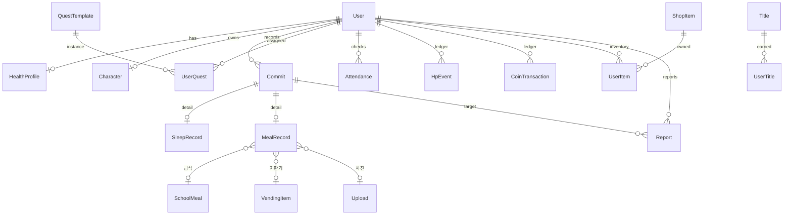

# 데이터 모델 설계 (초안)

노션 "커밋 헬스 기능" 목록을 바탕으로 만든 DB 구조 초안입니다.
아직 `apps/server/prisma/schema.prisma`에 반영하지 않았습니다. 기능별로 migration을 나눠 순서대로 추가합니다.

## 설계 원칙

1. **기록(Commit)은 사실만 저장하고, 보상은 원장(ledger)으로 남깁니다.**
   HP·코인은 `HpEvent`, `CoinTransaction`에 증감 내역을 쌓고, `Character.hp`, `User.coins`는 그 합계를 캐시합니다.
   신고가 받아들여져 기록이 무효가 되면, 원장에 반대 방향 항목을 추가해 되돌릴 수 있습니다.
2. **"하루"는 KST 기준의 `localDate`(DATE)로 저장합니다.**
   출석, 일일 퀘스트, 수면 기록이 모두 날짜 단위입니다. 자정을 넘겨 자는 경우를 고려해 하루의 경계(예: 04:00)를 상수로 정합니다.
3. **소유권 규칙**: 모든 사용자 데이터에 `userId`를 두고 `@CurrentUser().id`로 조회 범위를 제한합니다([auth.md](auth.md)).
4. **카탈로그와 사용자 데이터를 분리합니다.** 퀘스트·칭호·상점 아이템·자판기 메뉴는 관리자가 관리하는 카탈로그 테이블이고, 사용자 진행 상태는 별도 테이블에 둡니다.
5. **조건과 효과는 JSON으로 저장합니다.** 퀘스트 달성 조건, 칭호 획득 조건, 아이템 효과처럼 종류가 계속 늘어나는 값은 `Json` 컬럼에 넣고 서버 코드에서 타입을 검증합니다.

## 기능 ↔ 테이블 대응

| 기능                     | 테이블                                                           |
| ------------------------ | ---------------------------------------------------------------- |
| 로그인 / 회원가입        | `User`(기존 + 닉네임·학년·반·호실), `Session`, `OAuthAttempt`    |
| 온보딩                   | `HealthProfile`, `User.onboardedAt`                              |
| 튜토리얼                 | `User.tutorialDoneAt`                                            |
| 관리 시스템              | `User.role`, `AdminAuditLog`                                     |
| 측정 (수면·식사·세면 등) | `Commit`, `SleepRecord`, `MealRecord`, `VendingItem`             |
| 급식 API 연동            | `SchoolMeal`                                                     |
| 급식 사진 찍기           | `Upload`, `MealRecord`(식전·식후 사진, AI 판정 결과)             |
| hp 상태바                | `Character.hp`, `HpEvent`                                        |
| AI 캐릭터                | `Character`(청결도·기분), `UserQuest.source = AI`                |
| 퀘스트                   | `QuestTemplate`, `UserQuest`                                     |
| 출석체크                 | `Attendance`                                                     |
| 상점                     | `ShopItem`, `UserItem`, `CoinTransaction`                        |
| 칭호 (업적)              | `Title`, `UserTitle`, `User.equippedTitleId`                     |
| 신고 기능                | `Report`                                                         |
| 랭킹 (전체·반대항)       | 처음에는 집계 쿼리로 계산하고, 필요해지면 `RankingSnapshot` 추가 |

## 관계 개요



## Prisma 스키마 초안

기존 `User`, `Session`, `OAuthAttempt`에 추가하는 부분만 적었습니다.

```prisma
// ───────── 사용자 / 온보딩 / 관리 ─────────

enum Role {
  USER
  ADMIN
}

model User {
  id              String    @id @default(uuid()) @db.Uuid
  googleSub       String    @unique @db.VarChar(255)
  role            Role      @default(USER)
  nickname        String?   @unique @db.VarChar(20)  // 랭킹·신고에 노출되는 이름
  grade           Int?      @db.SmallInt             // 반대항 랭킹
  classNo         Int?      @db.SmallInt
  roomNo          String?   @db.VarChar(10)          // 기숙사 호실 (룸메이트 신고)
  coins           Int       @default(0)              // CoinTransaction 합계 캐시
  equippedTitleId String?   @db.Uuid
  onboardedAt     DateTime? @db.Timestamptz(3)       // null이면 온보딩 화면으로 이동
  tutorialDoneAt  DateTime? @db.Timestamptz(3)
  createdAt       DateTime  @default(now()) @db.Timestamptz(3)
  updatedAt       DateTime  @updatedAt @db.Timestamptz(3)

  sessions      Session[]
  profile       HealthProfile?
  character     Character?
  commits       Commit[]
  quests        UserQuest[]
  attendances   Attendance[]
  hpEvents      HpEvent[]
  coinTxs       CoinTransaction[]
  items         UserItem[]
  titles        UserTitle[]
  equippedTitle Title?      @relation("EquippedTitle", fields: [equippedTitleId], references: [id])
  reportsMade   Report[]    @relation("Reporter")
  reportsAbout  Report[]    @relation("ReportTarget")
  reportsReview Report[]    @relation("ReportReviewer")
  uploads       Upload[]

  @@index([grade, classNo])
}

/// 온보딩 응답. 건강 정보이므로 필요한 항목만 받습니다.
model HealthProfile {
  userId        String   @id @db.Uuid
  goals         String[]                  // 'GROW_TALLER', 'BETTER_SKIN', 'SLEEP_MORE' 등 코드
  goalNote      String?  @db.VarChar(200)
  heightCm      Decimal? @db.Decimal(4, 1)
  weightKg      Decimal? @db.Decimal(4, 1)
  weekdayFoods  String[]                  // 평소 자주 먹는 음식
  weekendFoods  String[]                  // 외출제·주말에 자주 먹는 음식
  conditionNote String?  @db.VarChar(500) // 현재 건강 상태 (자유 입력)
  updatedAt     DateTime @updatedAt @db.Timestamptz(3)
  user          User     @relation(fields: [userId], references: [id], onDelete: Cascade)
}

model AdminAuditLog {
  id        String   @id @default(uuid()) @db.Uuid
  adminId   String   @db.Uuid
  action    String   @db.VarChar(50)      // 'REPORT_ACCEPT', 'ITEM_UPDATE' 등
  targetRef String?  @db.VarChar(100)
  detail    Json?
  createdAt DateTime @default(now()) @db.Timestamptz(3)

  @@index([adminId, createdAt])
}

// ───────── 캐릭터 / HP ─────────

model Character {
  userId      String   @id @db.Uuid
  name        String   @db.VarChar(20)
  hp          Int      @default(100)      // HpEvent 합계 캐시, 0..maxHp
  maxHp       Int      @default(100)
  cleanliness Int      @default(100)      // 안 씻으면 감소 → 캐릭터가 더러워짐
  appearance  Json     @default("{}")     // 장착한 꾸미기 아이템 id
  updatedAt   DateTime @updatedAt @db.Timestamptz(3)
  user        User     @relation(fields: [userId], references: [id], onDelete: Cascade)
}

enum HpReason {
  QUEST_COMPLETE
  COMMIT            // 물 마시기, 씻기 등 기록 보상
  CAFFEINE          // 카페인 과다
  LATE_SLEEP        // 늦게 잠
  MEAL_SKIPPED      // 밥 안 먹음
  ITEM_USE          // HP 부활약
  REPORT_PENALTY
  ADMIN_ADJUST
  REVERSAL          // 무효가 된 기록의 보상 회수
}

model HpEvent {
  id        String   @id @default(uuid()) @db.Uuid
  userId    String   @db.Uuid
  delta     Int
  reason    HpReason
  refType   String?  @db.VarChar(30)      // 'Commit' | 'UserQuest' | 'Report' ...
  refId     String?  @db.Uuid
  localDate DateTime @db.Date
  createdAt DateTime @default(now()) @db.Timestamptz(3)
  user      User     @relation(fields: [userId], references: [id], onDelete: Cascade)

  @@index([userId, localDate])
  @@index([refType, refId])
}

// ───────── 측정 (커밋하기) ─────────

enum CommitType {
  SLEEP     // SleepRecord
  MEAL      // MealRecord
  WASH      // 씻기
  WATER     // amount = 컵 수
  CAFFEINE  // amount = mg
  EXERCISE  // amount = 분
}

enum CommitStatus {
  VALID
  UNDER_REVIEW  // 신고가 접수된 상태
  INVALIDATED   // 신고가 받아들여짐 → 보상 회수
}

model Commit {
  id         String       @id @default(uuid()) @db.Uuid
  userId     String       @db.Uuid
  type       CommitType
  status     CommitStatus @default(VALID)
  localDate  DateTime     @db.Date
  occurredAt DateTime     @db.Timestamptz(3)
  amount     Int?
  note       String?      @db.VarChar(200)
  createdAt  DateTime     @default(now()) @db.Timestamptz(3)

  user    User         @relation(fields: [userId], references: [id], onDelete: Cascade)
  sleep   SleepRecord?
  meal    MealRecord?
  reports Report[]

  @@index([userId, localDate, type])
}

/// "자기 전" 버튼으로 생성하고 "일어난 후" 버튼으로 wokeAt을 채웁니다.
model SleepRecord {
  commitId String    @id @db.Uuid
  sleptAt  DateTime  @db.Timestamptz(3)
  wokeAt   DateTime? @db.Timestamptz(3)
  commit   Commit    @relation(fields: [commitId], references: [id], onDelete: Cascade)
}

enum MealType {
  BREAKFAST
  LUNCH
  DINNER
  SNACK
}

enum MealSource {
  CAFETERIA  // 급식 → schoolMealId
  VENDING    // 학교 자판기 → vendingItemId
  OUTSIDE    // 외출·배달 등
  SKIPPED    // 안 먹음
}

enum AiVerdict {
  PENDING
  ATE_MOST
  ATE_SOME
  BARELY
  INVALID_PHOTO
}

model MealRecord {
  commitId      String     @id @db.Uuid
  mealType      MealType
  source        MealSource
  schoolMealId  String?    @db.Uuid
  vendingItemId String?    @db.Uuid
  foodText      String?    @db.VarChar(200)  // OUTSIDE일 때 직접 입력
  beforePhotoId String?    @db.Uuid
  afterPhotoId  String?    @db.Uuid
  aiVerdict     AiVerdict?
  aiEatenRatio  Int?       @db.SmallInt      // 0~100
  aiDetail      Json?                       // 모델명, 근거 요약 등

  commit      Commit       @relation(fields: [commitId], references: [id], onDelete: Cascade)
  schoolMeal  SchoolMeal?  @relation(fields: [schoolMealId], references: [id])
  vendingItem VendingItem? @relation(fields: [vendingItemId], references: [id])
  beforePhoto Upload?      @relation("BeforePhoto", fields: [beforePhotoId], references: [id])
  afterPhoto  Upload?      @relation("AfterPhoto", fields: [afterPhotoId], references: [id])
}

/// NEIS 급식 API 캐시. 배치 작업으로 한 주 단위로 받아 옵니다.
model SchoolMeal {
  id        String       @id @default(uuid()) @db.Uuid
  date      DateTime     @db.Date
  mealType  MealType
  dishes    String[]
  kcal      Decimal?     @db.Decimal(6, 1)
  raw       Json                              // 원본 응답 (영양 정보 등)
  fetchedAt DateTime     @default(now()) @db.Timestamptz(3)
  records   MealRecord[]

  @@unique([date, mealType])
}

/// 학교 자판기 메뉴 (관리자 관리)
model VendingItem {
  id         String       @id @default(uuid()) @db.Uuid
  name       String       @db.VarChar(50)
  caffeineMg Int          @default(0)
  kcal       Int?
  active     Boolean      @default(true)
  records    MealRecord[]
}

model Upload {
  id         String   @id @default(uuid()) @db.Uuid
  userId     String   @db.Uuid
  storageKey String   @unique @db.VarChar(300)  // 오브젝트 스토리지 키 (DB에는 이미지 자체를 넣지 않음)
  mimeType   String   @db.VarChar(50)
  sizeBytes  Int
  createdAt  DateTime @default(now()) @db.Timestamptz(3)
  user       User     @relation(fields: [userId], references: [id], onDelete: Cascade)

  beforeOf MealRecord[] @relation("BeforePhoto")
  afterOf  MealRecord[] @relation("AfterPhoto")
}

// ───────── 퀘스트 / 출석 ─────────

enum QuestSource {
  SYSTEM  // 템플릿에서 매일 배정
  AI      // AI 캐릭터가 사용자 기록을 보고 생성
}

enum QuestStatus {
  ACTIVE
  COMPLETED
  EXPIRED
}

model QuestTemplate {
  id         String      @id @default(uuid()) @db.Uuid
  code       String      @unique @db.VarChar(50)  // 'daily-water-4'
  title      String      @db.VarChar(100)
  condition  Json        // { commitType: 'WATER', count: 4 }
  rewardHp   Int         @default(0)
  rewardCoin Int         @default(0)
  active     Boolean     @default(true)
  quests     UserQuest[]
}

model UserQuest {
  id          String      @id @default(uuid()) @db.Uuid
  userId      String      @db.Uuid
  templateId  String?     @db.Uuid               // AI 퀘스트는 null일 수 있음
  source      QuestSource
  localDate   DateTime    @db.Date
  title       String      @db.VarChar(100)       // 템플릿 제목 복사 또는 AI 문구
  condition   Json
  progress    Int         @default(0)
  target      Int
  rewardHp    Int
  rewardCoin  Int
  status      QuestStatus @default(ACTIVE)
  completedAt DateTime?   @db.Timestamptz(3)

  user     User           @relation(fields: [userId], references: [id], onDelete: Cascade)
  template QuestTemplate? @relation(fields: [templateId], references: [id])

  @@index([userId, localDate])
}

model Attendance {
  userId    String   @db.Uuid
  localDate DateTime @db.Date
  streak    Int                               // 연속 출석 일수 (보상 계산용)
  createdAt DateTime @default(now()) @db.Timestamptz(3)
  user      User     @relation(fields: [userId], references: [id], onDelete: Cascade)

  @@id([userId, localDate])
}

// ───────── 코인 / 상점 ─────────

enum CoinReason {
  ATTENDANCE
  QUEST_COMPLETE
  PURCHASE
  ADMIN_ADJUST
  REVERSAL
}

model CoinTransaction {
  id        String     @id @default(uuid()) @db.Uuid
  userId    String     @db.Uuid
  delta     Int
  reason    CoinReason
  refType   String?    @db.VarChar(30)
  refId     String?    @db.Uuid
  createdAt DateTime   @default(now()) @db.Timestamptz(3)
  user      User       @relation(fields: [userId], references: [id], onDelete: Cascade)

  @@index([userId, createdAt])
}

enum ItemCategory {
  PROFILE_DECOR    // 프로필 꾸미기
  CHARACTER_DECOR  // 캐릭터 꾸미기
  CONSUMABLE       // HP 부활약 등
}

model ShopItem {
  id       String       @id @default(uuid()) @db.Uuid
  code     String       @unique @db.VarChar(50)
  name     String       @db.VarChar(50)
  category ItemCategory
  price    Int
  effect   Json?        // { hp: 30 } 등
  assetKey String?      @db.VarChar(200)
  active   Boolean      @default(true)
  owners   UserItem[]
}

model UserItem {
  userId   String   @db.Uuid
  itemId   String   @db.Uuid
  quantity Int      @default(1)   // 소모품 수량, 꾸미기 아이템은 1
  equipped Boolean  @default(false)
  user     User     @relation(fields: [userId], references: [id], onDelete: Cascade)
  item     ShopItem @relation(fields: [itemId], references: [id])

  @@id([userId, itemId])
}

// ───────── 칭호 (업적) ─────────

model Title {
  id          String      @id @default(uuid()) @db.Uuid
  code        String      @unique @db.VarChar(50)  // 'most-diligent'
  name        String      @db.VarChar(50)          // '가장 부지런한'
  description String      @db.VarChar(200)
  condition   Json                                 // { type: 'WASH_STREAK', days: 30 }
  hidden      Boolean     @default(false)
  earned      UserTitle[]
  equippedBy  User[]      @relation("EquippedTitle")
}

model UserTitle {
  userId   String   @db.Uuid
  titleId  String   @db.Uuid
  earnedAt DateTime @default(now()) @db.Timestamptz(3)
  user     User     @relation(fields: [userId], references: [id], onDelete: Cascade)
  title    Title    @relation(fields: [titleId], references: [id])

  @@id([userId, titleId])
}

// ───────── 신고 ─────────

enum ReportStatus {
  PENDING
  ACCEPTED   // 대상 Commit을 INVALIDATED로 바꾸고 보상 회수 + 패널티
  REJECTED
}

model Report {
  id           String       @id @default(uuid()) @db.Uuid
  reporterId   String       @db.Uuid
  targetUserId String       @db.Uuid
  commitId     String?      @db.Uuid
  reason       String       @db.VarChar(500)
  status       ReportStatus @default(PENDING)
  reviewerId   String?      @db.Uuid
  reviewedAt   DateTime?    @db.Timestamptz(3)
  createdAt    DateTime     @default(now()) @db.Timestamptz(3)

  reporter   User    @relation("Reporter", fields: [reporterId], references: [id], onDelete: Cascade)
  targetUser User    @relation("ReportTarget", fields: [targetUserId], references: [id], onDelete: Cascade)
  reviewer   User?   @relation("ReportReviewer", fields: [reviewerId], references: [id])
  commit     Commit? @relation(fields: [commitId], references: [id], onDelete: SetNull)

  @@unique([reporterId, commitId])  // 같은 기록은 한 번만 신고
  @@index([status, createdAt])
}
```

## 주요 흐름

- **커밋 저장**: 트랜잭션 하나에서 `Commit`과 상세 기록을 저장 → 관련 `UserQuest.progress`를 올림 → 퀘스트가 완료되면 `HpEvent`와 `CoinTransaction`을 추가 → `Character.hp`와 `User.coins`를 갱신합니다.
- **HP 감소 판정**: 하루가 끝날 때 배치 작업이 전날 기록을 확인합니다. 수면 시각, 카페인 합계, 식사를 거른 횟수, 세면 여부를 보고 `HpEvent`를 추가하고 `cleanliness`를 낮춥니다.
- **출석**: 그날 첫 `/auth/me` 요청 또는 명시적인 버튼으로 `Attendance`를 만듭니다. 기본 키 `(userId, localDate)`가 하루 한 번만 기록되도록 보장합니다.
- **랭킹**
  - 전체: 기간(예: 주간) 동안의 `HpEvent` 양수 합계, 또는 퀘스트 완료 수로 계산합니다.
  - 반대항: 같은 값을 `User.grade, classNo`로 묶어 평균을 냅니다.
  - 사용자가 늘어 쿼리가 느려지면 `RankingSnapshot(period, scope, key, score, rank)` 테이블로 미리 계산해 둡니다.

## 결정이 필요한 사항

1. **개인정보 범위**: 현재 정책상 이메일·이름을 저장하지 않습니다. 랭킹과 신고에는 닉네임, 반대항에는 학년·반, 룸메이트 신고에는 호실이 필요합니다. 이 정보를 받을지 정해야 합니다.
2. **사진 저장소**: Vercel Blob, S3, R2 중 무엇을 쓸지, 보관 기간은 얼마로 할지 정해야 합니다. 예를 들어 AI 판정 뒤 30일이 지나면 삭제할 수 있습니다.
3. **하루의 경계 시각**: 자정과 새벽 4시 중 무엇으로 할지 정해야 합니다.
4. **업적과 칭호의 관계**: 이 초안에서는 업적 페이지를 칭호 목록으로 보고 합쳤습니다. 둘을 분리해야 한다면 `Achievement` 테이블을 추가합니다.
5. **HP 0의 의미**: HP가 0이 됐을 때의 상태(예: "치료된 좀비", "폐인")를 칭호로 표현할지, `Character`의 상태 값으로 둘지 정해야 합니다.
